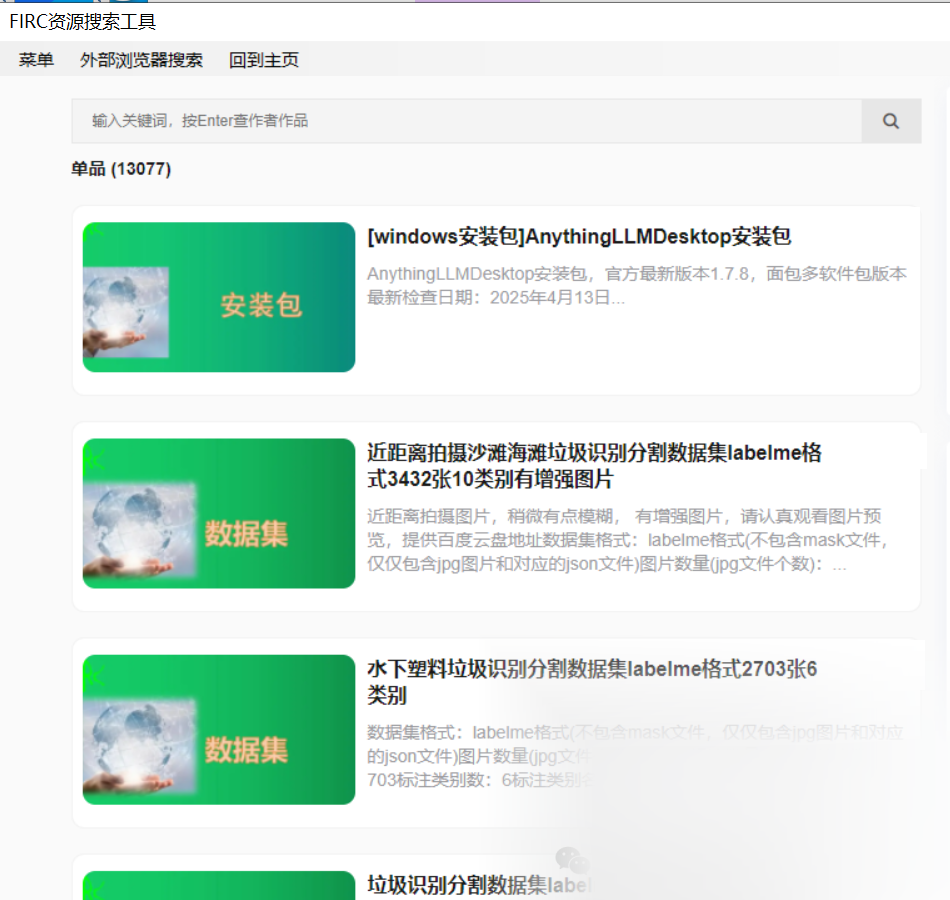

# FIRC Resource Search and Download Tool User Guide

**Overview**:

FIRC Resource Search Download Tool is a resource search tool specifically designed for Windows users. This tool can help you quickly find the required datasets, whl files, software, and documents among other resources. This tutorial will detail how to use the FIRC Resource Search Download Tool to ensure full utilization of its features.

Software interface:

Step 1: Install and download the FIRC resource search tool.

1.

Open any web browser and enter "FIRC resource search tool" in the search box and press Enter.

1.

Locate the "[windows installation package] AnythingLLMDesktop installation package" in the search results, and click the download button to initiate the download.

Step 2: Start the FIRC resource search tool.

1.

After installation, locate the FIRC resource search tool's shortcut on your desktop or start menu, and double-click to launch it.

1.

The tool interface consists of three main parts: menu, external browser search and back to home page. You can perform different operations through these options.

**Step 3: Use the resource search function.**

1.

On the main interface of the tool, you will see an input box where you can enter the keywords you want to search for, such as "dataset".

1.

Press Enter, and the tool will automatically search for relevant resources in the background and display the results in the list below.

Step 4: View and select resources

1.

In the search results, you will find various types of resources, such as "Close-up Beach Scenery with Trash Identification and Segmentation Dataset - LabelMe Format - 3432 Images in 10 Categories with Enhanced Images".

1.

Each resource item is marked with detailed information, which you can find in the introduction section.

1.

Clicking on a resource item allows for detailed examination of the resource, such as datasets. These include details about the dataset format, number of images, and number of annotations. For instance, "Close-up Beach Waste Identification and Segmentation Dataset" provides 3432 labeled images, making it highly suitable for research and development projects related to this topic.

Step 5: Download resources

1.

After selecting the resources you need, click the download button on the right side of the resource item to start downloading.

1.

After the download is completed, you can view the storage location of the downloaded files in the settings of the tool and manage them accordingly.

**Additional Features and Usage Tips**:

1. **Unscheduled updates**

The FIRC resource search tool's resources are updated intermittently, ensuring you can access the latest resources.

1. **Multi-resource Search**

In addition to the dataset, you can also search for WHL files, software, and documentation resources to meet your diverse needs.

1. **External browser search**

If you need to search resources in an external browser, you can click the "External Browser Search" option. The tool will automatically open the default browser and load the relevant search page.

**Summary**:

Through the FIRC resource search and download tool, you can conveniently find and download the required datasets, whl files, software, and documents. The resources of this tool are updated periodically, and we welcome users to download and use it. We hope this tutorial will help you better use the FIRC resource search and download tool to find the resources you need.

Software address: gitee.com/FIRC/firc-resource-downloader

## Payment

Here is a pay link on Stripe ( https://buy.stripe.com/3cs8yP7sY87d0vu9AB ). Please contact me lonlonago@foxmail.com after funding $89, and I will send you a complete data files , thank you!

